<div align="center">

# ⚔️ Archives de la Faille

**Plateforme d'analyse de données League of Legends pour une équipe amateur :<br>du suivi de performance à l'optimisation statistique du champion pool.**


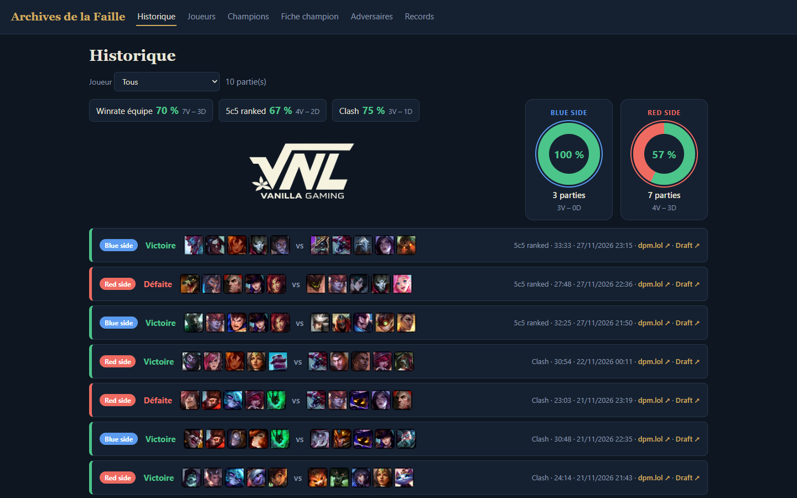

</div>

---

## 💡 L'idée

Mon équipe joue en compétition amateur (Clash, 5c5 classé). Comme beaucoup d'équipes, nos décisions de draft reposaient sur le ressenti : *« je suis bon sur ce champion »*, *« ce matchup est perdu »*. Les sites grand public (op.gg, lolalytics…) donnent des statistiques **globales**, mais ne répondent pas aux questions qui nous intéressent vraiment :

- 🎯 **Où se situe chaque joueur** par rapport au niveau Émeraude+, Diamant, Master, à son poste ?
- 🧩 **Quels 5 champions** un joueur devrait-il maîtriser pour couvrir un maximum de matchups, compte tenu de **ce qu'il sait déjà jouer** ?
- 🛡️ **Quel champion peut-on choisir en premier** (« blind pick ») sans se faire contrer ?
- 🚫 **Quels bans** protègent le mieux notre pool ?

J'ai donc construit **Archives de la Faille** : un pipeline de données complet, de la collecte via l'API Riot jusqu'à un site web interactif, avec au cœur un **moteur d'optimisation statistique** du champion pool.

---

## 🧠 Ce que le projet démontre

| Compétence | Mise en œuvre dans le projet |
|---|---|
| **Collecte & ingénierie de données** | Client API Riot avec gestion du rate-limit, reprise sur interruption, cache incrémental des parties SoloQ/Flex de la saison |
| **Échantillonnage & statistiques descriptives** | Constitution d'un échantillon de **~2 300 joueurs Émeraude+** stratifié par rang et par rôle → percentiles 1 à 100 de chaque stat |
| **Inférence & correction de biais** | *True winrate* : correction du biais de sélection (matchups et synergies repondérés par les pick rates) |
| **Estimation bayésienne / shrinkage** | Winrates lissés par prior bêta, rétrécissement empirique des Δ2 de matchups selon leur erreur standard |
| **Optimisation combinatoire** | Recherche exhaustive ou échantillonnée (jusqu'à 600 000 pools), score multi-critères normalisé en écarts-types, contraintes |
| **Simulation Monte-Carlo** | Probabilité d'être contré en blind pick, analyse de sensibilité |
| **Data visualisation** | Radar, beeswarm, heatmaps, scatter plots… tous dessinés à la main en SVG/JS, sans librairie |
| **Mise en production** | Serveur WSGI (Gunicorn) sur Render, cache HTTP (ETag, gzip), données précalculées pour tenir dans 512 Mo de RAM |

---

## ✨ Fonctionnalités

### 1. Suivi des performances de l'équipe

Chaque partie de l'équipe est téléchargée (match + timeline) et analysée : KDA, participation aux kills, écart d'or et de CS à 15 min, dégâts par minute, part des dégâts… Le tableau **Joueurs** compare chaque stat entre joueurs du même rôle avec un code couleur.

<p align="center">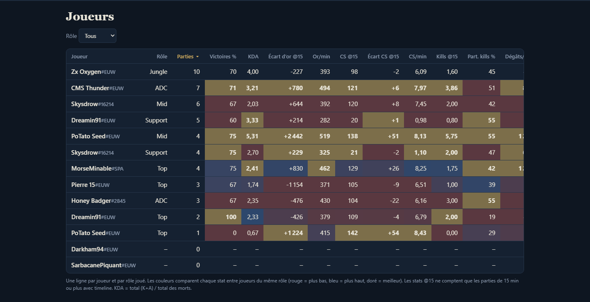</p>

### 2. Profil joueur vs. le reste du ladder

Grâce aux percentiles calculés sur l'échantillon Émeraude+, chaque joueur est positionné sur un **radar** face aux moyennes Émeraude, Diamant et Master de son poste. Des badges automatiques (*« Maître du 1v1 »*, *« Mauvais KDA »*…) résument ses points forts et faibles.

<p align="center">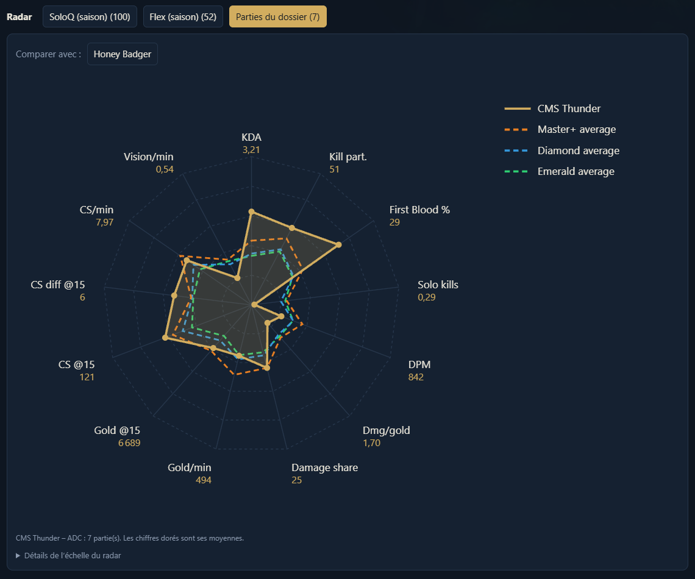</p>

Le **scatter winrate × écart d'or à 15 min** sépare les champions sur lesquels le joueur *gagne sa lane* de ceux sur lesquels il *gagne la partie*, avec la taille de l'icône proportionnelle au playrate.

<p align="center">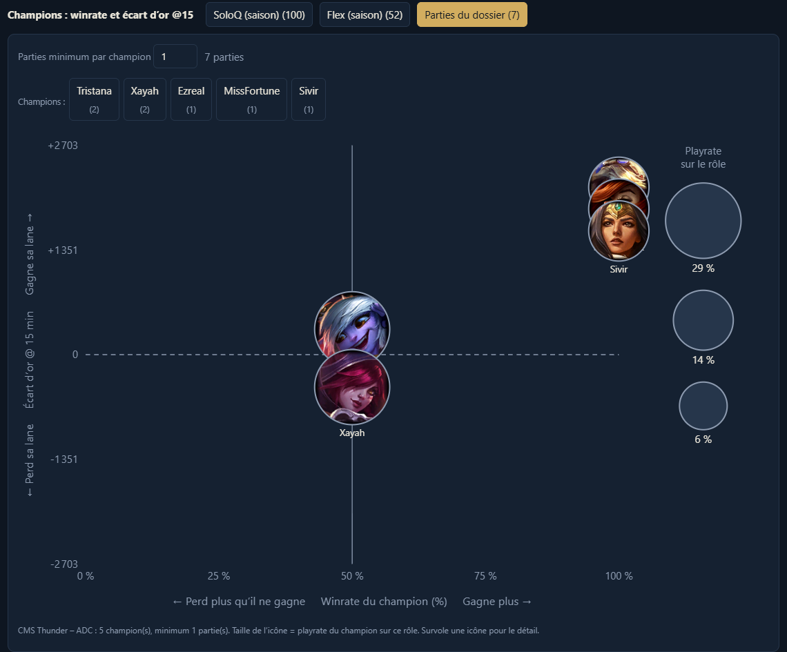</p>

### 3. 🏆 Champion pool conseillé : le moteur d'optimisation

C'est le cœur du projet. Pour chaque couple (joueur, rôle), l'algorithme cherche **le meilleur pool de 5 champions** :

1. **Champions obligatoires** détectés à partir de l'historique du joueur (*ajout forcé* si le champion représente ≥ 25 % de ses parties avec un WR > 47 %, *maîtrise* via un score qui combine volume, winrate lissé et z-score de performance).
2. **Places restantes** choisies parmi les champions méta du rôle, en maximisant un score :

$$
\text{score} = \sum_{t \,\in\, \{\text{lane},\,\text{out},\,\text{syn},\,\text{mastery}\}} w_t \cdot \frac{T_t(\text{pool}) - \mu_t}{\sigma_t}
$$

   où chaque terme est **normalisé en écarts-types** par rapport à 20 000 pools aléatoires, ce qui rend les critères comparables :
   - **lane** : couverture des adversaires directs (moyenne des 2 meilleures réponses du pool à chaque adversaire, pondérée par son pick rate) ;
   - **out** : couverture des matchups des autres lanes ;
   - **syn** : synergie avec les champions alliés ;
   - **mastery** : maîtrise du joueur sur les champions du pool.
3. **Contrainte** : au moins un champion « blindable » (probabilité d'être contré < 50 %).

L'utilisateur peut **verrouiller** ou **bannir** des champions : le serveur recalcule les 10 meilleurs pools à la volée.

<p align="center">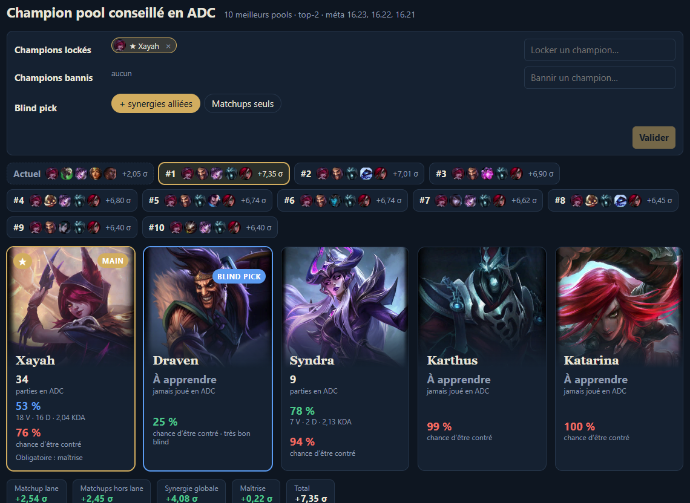</p>

La **heatmap des Δ2** montre pour chaque champion du pool l'avantage attendu (en points de winrate) contre chaque adversaire de lane, triés par couverture. Les **5 bans conseillés** visent d'abord les counters du blind pick, puis les adversaires les moins bien couverts.

<p align="center">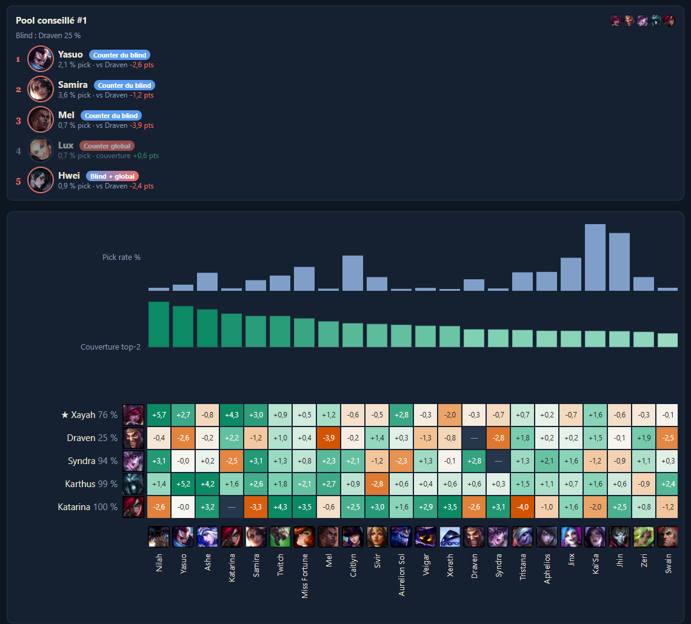</p>

En draft, la vue **« Qui jouer en priorité »** donne directement la meilleure réponse du pool à chaque pick adverse :

<p align="center">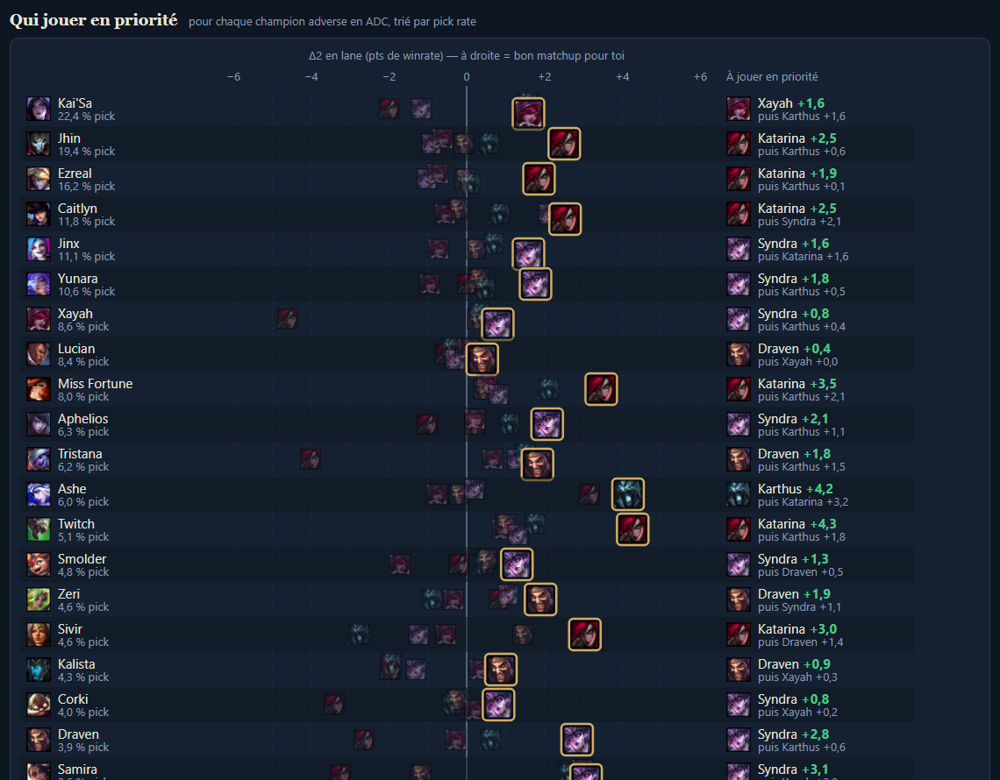</p>

### 4. Blindability : peut-on pick en premier ?

Pour chaque champion, on estime la **probabilité qu'au moins un adversaire (ou un allié adverse via les synergies) ait un counter dans son pool**. Le classement est validé par analyse de sensibilité et simulation Monte-Carlo.

<p align="center">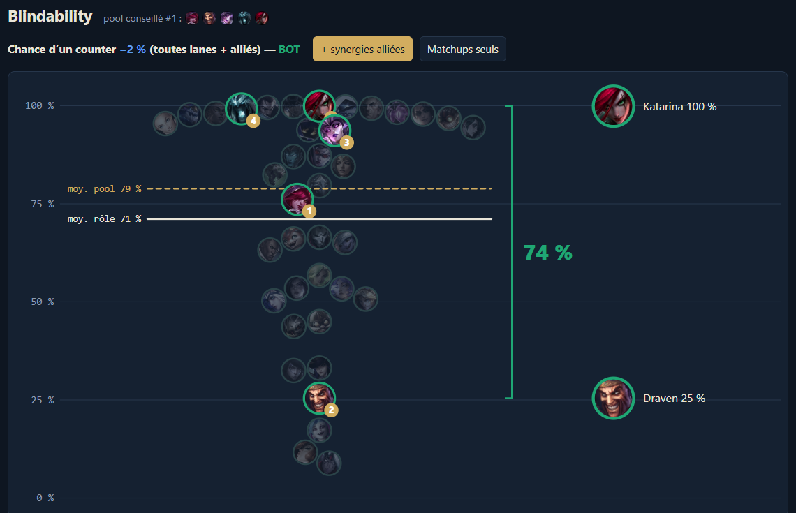</p>

### 5. Fiche champion : la méta, corrigée de ses biais

Pour chaque champion et chaque rôle : **true winrate** (winrate brut moins le biais de sélection lié aux matchups et synergies du patch), courbe de **winrate selon la durée de partie** (scaling), base de joueurs normalisée (*niche* vs *populaire*), counters et synergies.

<p align="center">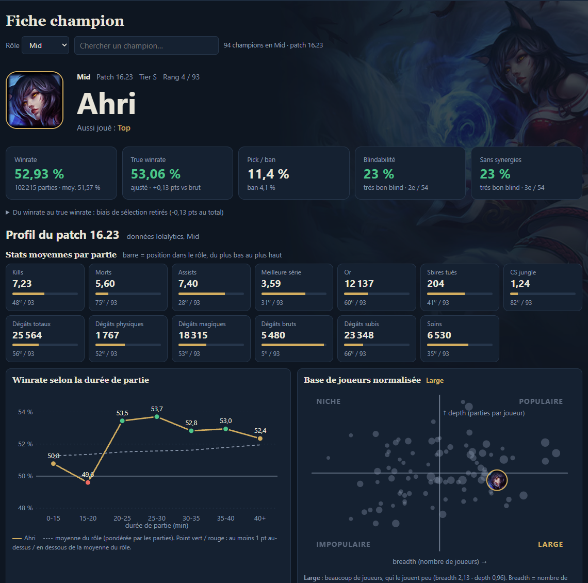</p>

Le **beeswarm des Δ2** de matchups agrège plusieurs patchs avec leurs intervalles de confiance :

<p align="center">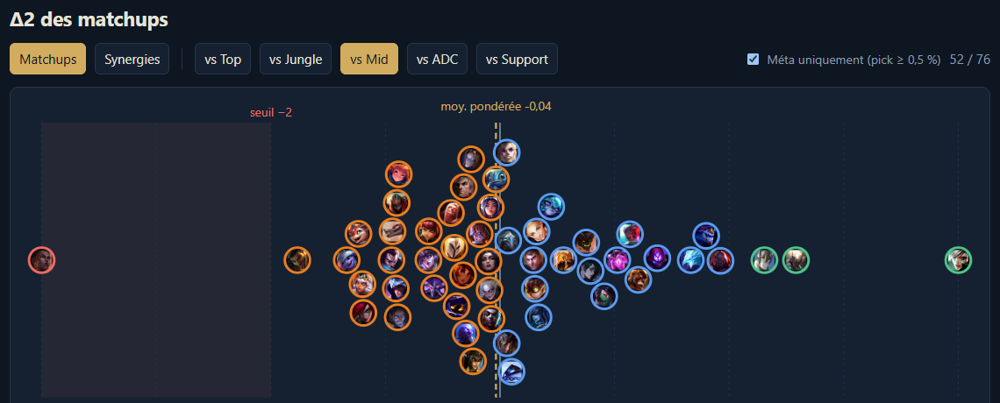</p>

### 6. Et aussi…

<table>
<tr>
<td width="50%">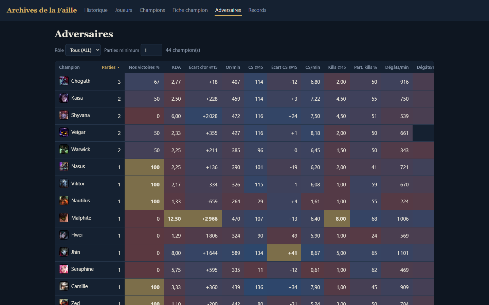<p align="center"><b>Adversaires</b> : nos winrates contre chaque champion affronté</p></td>
<td width="50%">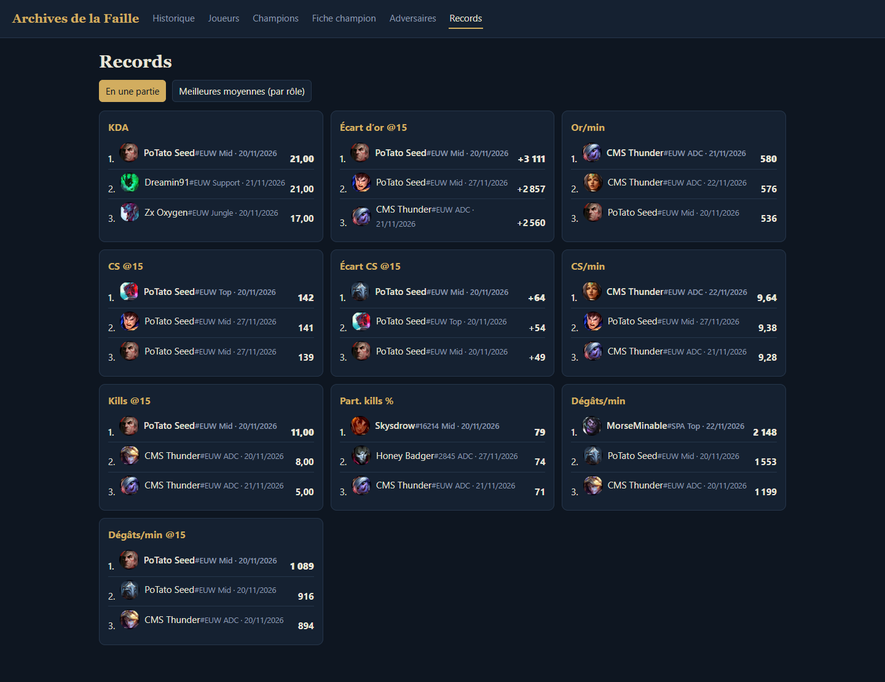<p align="center"><b>Records</b> : les meilleures performances de l'équipe</p></td>
</tr>
</table>

---

## 🔬 Méthodologie en bref

<details>
<summary><b>Δ2 : l'avantage d'un matchup, corrigé</b></summary>

Le winrate brut d'un champion A contre B est biaisé : si A est fort sur le patch, il gagne contre tout le monde. Le **Δ2** mesure l'écart entre le winrate observé de la paire et celui attendu d'après les *true winrates* des deux champions, moyenné sur plusieurs patchs avec un intervalle de confiance à 95 %.

Les Δ2 sont ensuite **rétrécis** (shrinkage empirique bayésien) vers la moyenne du champion : `Δ2* = μ + (Δ2 − μ) · τ² / (τ² + SE²)`. Un matchup observé sur peu de parties est ainsi ramené vers la moyenne au lieu de dominer l'optimisation.
</details>

<details>
<summary><b>Score de maîtrise d'un joueur sur un champion</b></summary>

`score_B = ln(1 + n) × (wr_lissé / 0.5)^α × Perf`

- `wr_lissé = (victoires + 0.5·m) / (n + m)` : prior bêta centré sur 50 % ;
- `Perf` : z-score moyen de 7 stats (KDA, KP, DPM, GPM, CS/min, écarts d'or et de CS à 15 min) **relatif aux moyennes du joueur à ce poste**, borné dans [0.85 ; 1.15].
</details>

<details>
<summary><b>Percentiles Émeraude+</b></summary>

1. Pool de joueurs Émeraude+ échantillonné proportionnellement à la répartition des rangs (~12 000 comptes) ;
2. Profils agrégés : rôle principal + ~30 parties par joueur, quota par rôle (~2 300 profils retenus) ;
3. Percentiles 1 → 100 par rôle et par stat, utilisés pour les radars et les badges.

La collecte (~70 requêtes par joueur, clé API limitée) est interruptible et reprend où elle s'était arrêtée.
</details>

<details>
<summary><b>Optimisation à l'échelle de l'équipe</b></summary>

Le notebook `team_pool.ipynb` étend l'optimiseur à l'équipe entière : **descente coordonnée** où le pool de chaque joueur est optimisé en tenant compte des pools réels de ses 4 coéquipiers (terme de synergie d'équipe supplémentaire), jusqu'à convergence.
</details>

---

## 🏗️ Architecture

```
┌──────────────┐    ┌───────────────────────┐    ┌────────────────────┐    ┌──────────────┐
│  API Riot    │──▶│ download.py / ranked.py│──▶│  stats.py           │──▶│              │
│  (matchs,    │    │ cache incrémental      │    │ stats par partie   │    │              │
│  timelines)  │    └───────────────────────┘    └────────────────────┘    │  serve.py    │
└──────────────┘                                                           │  (WSGI,      │──▶ site/ (HTML/CSS/JS,
┌──────────────┐    ┌───────────────────────┐    ┌────────────────────┐    │  Gunicorn)   │    graphes SVG faits main)
│ Données méta │──▶│ notebooks Jupyter      │──▶│ prepare_data.py     │──▶│              │
│ (patchs)     │    │ Δ2, blindability,      │    │ pool_advice.py     │    │  API :       │
└──────────────┘    │ percentiles            │    │ (précalculs JSON)  │    │  /pool_advice│
                    └───────────────────────┘    └────────────────────┘    │  /champion   │
                                                                           └──────────────┘
```

| Fichier | Rôle |
|---|---|
| `download.py` | Télécharge les parties choisies (Clash, 5c5 classé) avec leur timeline |
| `ranked.py` | Met à jour le cache SoloQ / Flex de la saison pour chaque joueur suivi |
| `stats.py` | Calcule les stats de chaque participant (dont stats à 15 min issues des timelines) |
| `pool_advice.py` | Moteur d'optimisation du champion pool et des bans |
| `prepare_data.py` | Précalcule true winrates, biais de sélection et courbes de scaling |
| `serve.py` | Serveur WSGI : fichiers statiques, API de recalcul, cache HTTP / gzip |
| `notebooks/`, `percentiles/` | Exploration et méthodologie (pool individuel, pool d'équipe, percentiles) |

---

## 🚀 Lancer le projet

```bash
git clone https://github.com/juliendauphine/archives-de-la-faille.git
cd archives-de-la-faille
pip install -r requirements.txt

# Clé API Riot (https://developer.riotgames.com) dans key.txt
echo "RGAPI-xxxxxxxx" > key.txt

# Lancer le site en local : http://localhost:8000
python serve.py            # --update pour rafraîchir les parties SoloQ / Flex
```

Ajouter les joueurs suivis dans `players.txt` (`NomDeJeu#TAG$Role$ChampionFavori`), puis :

```bash
python download.py --player "Nom#TAG" --date 2026-11-21   # parties Clash / 5c5 d'une journée
python pool_advice.py                                      # recalcule les pools conseillés
```

---

## 👤 Auteur

**Julien S.**, Data Scientist

Ce projet est né d'un besoin concret de mon équipe et m'a permis de mener un projet data de bout en bout : définir les bonnes questions, collecter et nettoyer les données, construire des indicateurs statistiquement robustes, optimiser, visualiser, puis mettre le tout en production pour de vrais utilisateurs.

📫 Je suis à la recherche d'un poste en data science : n'hésitez pas à me contacter !
<!-- Ajoute ici tes liens : LinkedIn, e-mail, portfolio -->

---

<sub>*Archives de la Faille* n'est pas affilié à Riot Games. League of Legends et les visuels des champions sont la propriété de Riot Games, Inc.</sub>
